# How the tables fit together

Open this file with **Cmd+Shift+V** in Positron to see the diagram. The diagram is the docs' core ERD ([calcofi.io/docs/db.html#the-core-data-model](https://calcofi.io/docs/db.html#the-core-data-model)), which already includes `sample_track`.

The schema browser [calcofi.io/db-schema](https://calcofi.io/db-schema/) lists every table and column, but only for **public** releases. `sample_track` arrives with a dataset that is still under provider review, so it is in the docs but not yet in db-schema.

## One row of each core table

| table | one row is | its key | joins to |
|---|---|---|---|
| `sample` | where and when something was sampled: a cast, a bottle, a net tow, a filter, a transect | `sample_key` = `dataset:type:id` | itself (`parent_sample_key`, `root_sample_key`); `cruise` (`cruise_key`); `grid` (`grid_key`) |
| `obs_env` | one environmental value at one depth of a sample | `obs_id` | `sample` (`sample_key`); `measurement_type` |
| `obs_bio` | one organism count or density in a sample | `obs_id` | `sample` (`sample_key`); `taxon` (`taxon_key`) |
| `obs` | a view: `obs_bio` + `obs_env` stacked | | |
| `sample_measurement` | one value for a whole sample: a cast's mixed-layer depth, a tow's volume filtered | `sample_measurement_id` | `sample` (`sample_key`) |
| `obs_attribute` | a binned count behind an observation: a size class, a length bin | `obs_attribute_id` | `obs_bio` on `sample_key` + `taxon_key` + `life_stage` |
| `climatology` | the 1993–2013 baseline for one station × month × 10 m bin × type | | `obs_env` on dataset, site, month, depth bin, type |
| `sample_spatial` | a sample's membership in a region (a sanctuary, a Kahru area, a wind lease) | | `obs_*` (`root_id`); `spatial` (`spatial_key`) |
| `sample_track` *(coming)* | the path of a sample with extent: an effort segment, a line of sight | `sample_key` | `sample` (`sample_key`), at most one path per sample |

## Joins worth knowing

| to get | join |
|---|---|
| a bottle's cast (date, position, bottom depth) | `sample b JOIN sample c ON c.sample_key = b.root_sample_key` |
| the CTD cast at the same station visit as a bottle or net tow | match on `cruise_key` + `order_occ` |
| bottle-derived spiciness or TEOS-10 sigma-theta beside a bottle's values | the same `sample_key` (bottle-derived values sit on the bottle's own sample) |
| an observation's baseline | `climatology` on `dataset_key`, `site_key`, `measurement_type`, `depth_bin`, `month = cruise_month` |
| which region an observation falls in | `sample_spatial ss ON ss.root_id = o.root_id`, filtered on `ss.layer` |
| a taxon and its lineage | `obs_bio.taxon_key` → `taxon.taxon_key` (and `parent_taxon_key` upward) |

## Names that trip people up

- **Per depth or per cast?** A per-depth value is in `obs_env` and has a depth. A per-cast value is in `sample_measurement` and has none: mixed-layer depth, chlorophyll maximum, integrated chlorophyll, hypoxic, nitracline and pycnocline depths. [Why](https://calcofi.io/docs/db.html#sec-per-cast-grain)
- **"Cast" in the Bottle Database** means the rosette cast the bottles came up on (the provider's Cast file), not the CTD Cast Files dataset (`calcofi_ctd-cast`).
- **CTD series are sensor-pair averages:** the CTD's temperature is `temperature_ave`, while the bottle's is `temperature`.
- **Bottle data after May 2021:** the Bottle Database ends at cruise 2105. Later bottle values are the `btl_*` variables of the CTD Cast Files (`btl_temperature`, `salinity_btl`, `oxygen_btl_ml_l`, `btl_chlorophyll_a`, `btl_nitrate`), through the newest cruise.
- **`value` vs `measurement_value`:** `obs_env` and `obs_bio` use `value`; `sample_measurement` uses `measurement_value`.
- **`qual_ok`** is the provider's flag, already applied. Filter on it unless you are studying the flags themselves.
- **Keys:** `*_key` is a text key (`cruise_key` = `YYYY-MM-NODC`), `*_id` is an integer, and `site_key` is the station (`"090.0 053.0"`). [Keys and integrity](https://calcofi.io/docs/keys.html) · [Glossary](https://calcofi.io/docs/glossary.html)
